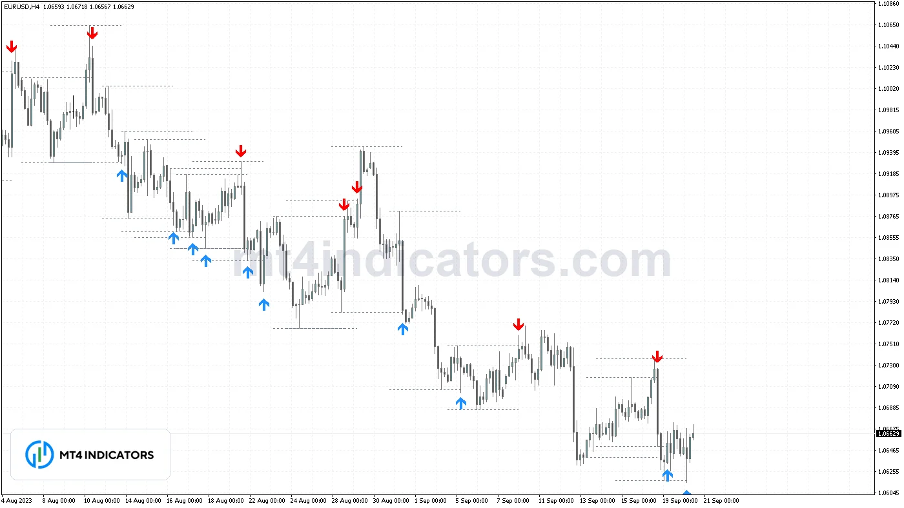

# False Breakout Indicator MT4 (Fakeout Detector)

False breakout (fakeout) detector. Builds a range from RangeBars candles, then marks the closed candle that closes back inside the range after price traded beyond it within ConfirmBars candles. Closed candles only; arrows never move or disappear.

**Full guide, settings explained and strategy examples:** [False Breakout Indicator MT4 (Fakeout Detector) on mt4indicators.com](https://mt4indicators.com/mt4-indicator/false-breakout-indicator-mt4/)

## Features
- Free and open source (MIT licence), MQL4 source included
- Non-repainting: signals are calculated on closed candles and do not move once drawn.
- Works on any symbol and timeframe in MetaTrader 4 (build 600 or later)

## Inputs
| Input | Default | What it does |
|---|---|---|
| `RangeBars` | `20` | Candles used to build the range (before the signal window) |
| `ConfirmBars` | `3` | Candles allowed for the poke and the close back inside |
| `MinPokePoints` | `0.0` | Minimum distance beyond the range, in points (0 = any) |
| `MaxBarsBack` | `2000` | How many candles of history to scan |
| `DrawRange` | `true` | Draw the range high and low as short segments |
| `BullColor` | `clrDodgerBlue` | Bullish fakeout (failed breakdown) color |
| `BearColor` | `clrRed` | Bearish fakeout (failed breakout) color |
| `RangeColor` | `clrSlateGray` | Range segment color |
| `AlertsOn` | `false` | Pop-up alert on a new fakeout |
| `PushOn` | `false` | Push notification to MT4 mobile |
| `SoundOn` | `false` | Play a sound on a new fakeout |
| `SoundFile` | `alert.wav` | Sound file |

## Installation
1. Download `false-breakout-indicator-mt4.mq4` from this repository.
2. In MetaTrader 4 open **File → Open Data Folder → MQL4 → Indicators** and copy the file there.
3. Right-click **Indicators** in the Navigator and choose **Refresh** (or restart MT4).
4. Drag the indicator onto a chart.

Step-by-step screenshots: [How to install indicators in MT4](https://mt4indicators.com/how-to-install-indicators-mt4/).

## More free indicators
Browse 70+ free MetaTrader indicators, each checked for repainting, at [mt4indicators.com](https://mt4indicators.com/mt4-indicators/).

## Disclaimer
Trading foreign exchange on margin carries a high level of risk. This indicator is a charting tool, not trading advice. Test it on a demo account first.
